<!--
  github.com/antonsoo  ·  profile README
  The banner, the cards, and the ledger are generated by code in this repo
  (see /scripts); text is baked to vector paths, so the Greek (and the Hebrew,
  and the Gothic) renders identically everywhere. Curiosity is welcome.
-->


 

<strong>ANTHONY</strong> &nbsp;·&nbsp; my own pages

Looking for the app? <a href="https://praviel.com"><strong>praviel.com</strong></a>. PRAVIEL's other pages are further down, under <em>What I am building</em>.

<em>AI/ML and software engineer in San Francisco. I build LLM systems, the software around them, and the tests that say whether either works.</em>

## About &nbsp;·&nbsp; Dē mē

- **AI/ML and software engineer.** Master's in artificial intelligence from the Institute of Science Tokyo, where I trained speech recognition models on supercomputers. Since then: production document AI at Quantiphi, LLM agents and jailbreak research at a small company of my own, and full-stack work from the backend to both app stores.
- Founder and lead engineer of **[PRAVIEL](https://praviel.com)**, a lessons-first app that teaches ancient languages as living, speakable systems. I designed it, I built it, and I run it.
- I publish small open-source tools: for engineers who build with language models (eval statistics, agent traces, PII masking, MCP linting, LoRA merges), for developers at large, for speedrunners, and for anyone who wants to know what time it is in Babylon or how Hero aimed a tunnel. They are below, under *Opera minora*.
- I fix other people's projects too, and a good many of the fixes have been merged: [ESPnet](https://github.com/espnet/espnet), [Lhotse](https://github.com/lhotse-speech/lhotse), [Kornia](https://github.com/kornia/kornia), [Pipecat](https://github.com/pipecat-ai/pipecat), [Gymnasium](https://github.com/Farama-Foundation/Gymnasium), [raylib](https://github.com/raysan5/raylib), [Pillow](https://github.com/python-pillow/Pillow), the historical linguists' [LingPy](https://github.com/lingpy/lingpy), and a long tail of scientific Python. The roll is below, under *Symbolae*.
- Native in English, Russian, and Ukrainian; Japanese earned over four years in Tokyo; Chinese barely past counting to ten. Five living languages is decent training for reviving the silent ones, which these days I am learning myself: Latin, Ancient Greek, Hebrew, Sanskrit, and the rest of the syllabus.
- In Latin I am *Antōnius Mercātor*. The *h* in Anthony crept in later, from a guess that the name was Greek *ánthos*, "flower"; the Romans never wrote one. A mercer sold fine cloth and a *mercātor* sold anything. Plautus wrote a whole comedy called *Mercator*, and a Flemish schoolboy named Gerard Kremer ("merchant") took the Latin for his own and, as Mercator, redrew the world. His grid is the faint one behind my name at the top of this page.
- I care about evidence, provenance, and shipping. Order depends on the day.
- In San Francisco, in person. Open to AI/ML and software engineering work, full time or contract, and always open to a conversation about languages. <a href="mailto:anthony@praviel.com">anthony@praviel.com</a>

## What I am building &nbsp;·&nbsp; Opera

*PRAVIEL rests on one small heresy: the old languages are not dead, only unspoken, and unspoken is a curable condition. My test for a lesson is plain: not whether you can parse an old language, but whether you can say it aloud and be understood.*

<table>
<tr>
<td width="150" align="center" valign="middle">
  <a href="https://praviel.com">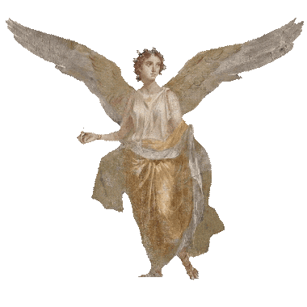</a>
</td>
<td valign="middle">

**PRAVIEL: Ancient Languages.** Duolingo proved that five minutes a day can carry a language; PRAVIEL points that habit at Latin, Ancient Greek, and nine other ancient tongues, and holds it to a scholar's standard. Short daily lessons in speaking, listening, and reading, with reconstructed pronunciation you can actually hear. Hold a conversation with a historical persona, or tap any word of a real text to take it apart. Built for beginners, checked by experts. Free to start, on web, iPhone, and Android.

<strong>PRAVIEL</strong> &nbsp;·&nbsp; the company's pages, not mine

</td>
</tr>
</table>

Under the hood: one <strong>Flutter and Dart</strong> codebase carries the app to iPhone, Android, and the web; the marketing site is <strong>Next.js on Node</strong> at praviel.com; the AI tutors keep their sources in order. The languages remain the hard part.

**Also on the bench.** A private research stack for systematic trading, under QuantGenAI: seven repositories that keep market data, research, laboratory, execution, and monitoring apart, with versioned contracts between them and a risk kernel allowed to refuse anything the laboratory approved. The interesting part is not a strategy. It is that the apparatus is calibrated against planted effects and deliberately contaminated data, so it can tell a real result from an artifact of how the panel was assembled. I have turned it on my own best finding more than once, and lost. Nothing there has earned the right to trade, and nothing claims to have.

## Open-source tools &nbsp;·&nbsp; Opera minora

A growing shelf of small tools, MIT-licensed, and most of them run in the browser with nothing to install. Many serve the people who build with language models, others serve developers at large, a whole wing works the sciences of the ancient world, and a few are for players who suspect the game is lying to them. The whole shelf, with pictures: **[antonsoo.github.io/officina](https://antonsoo.github.io/officina/)**. Four of the engineering tools also run as [Hugging Face Spaces](https://huggingface.co/collections/tonymerx/engineering-workbenches), with the Python running in your browser.

<table>
<tr>
<td width="33%" valign="top">
<a href="https://antonsoo.github.io/errorbars/">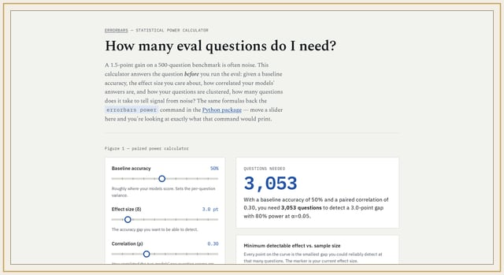</a>
 <strong><a href="https://github.com/antonsoo/errorbars">errorbars</a></strong> 
Error bars for LLM evals, and how many questions you actually need.
</td>
<td width="33%" valign="top">
<a href="https://antonsoo.github.io/tracelens/">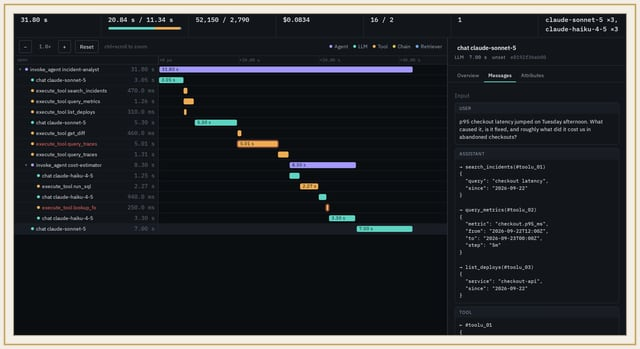</a>
 <strong><a href="https://github.com/antonsoo/tracelens">tracelens</a></strong> 
Every model call, tool call, token, and dollar of an agent run, on one timeline.
</td>
<td width="33%" valign="top">
<a href="https://antonsoo.github.io/veil/">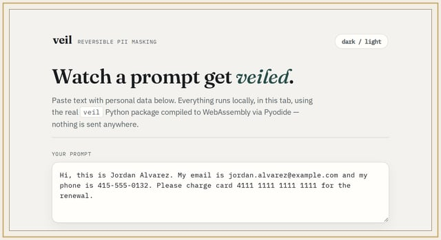</a>
 <strong><a href="https://github.com/antonsoo/veil">veil</a></strong> 
Reversible masking of personal data in LLM calls, restored even mid-stream.
</td>
</tr>
<tr>
<td width="33%" valign="top">

 <strong><a href="https://github.com/antonsoo/fieldproof">fieldproof</a></strong> 
Document extraction that shows its work: every field tied to the words it came from.
</td>
<td width="33%" valign="top">
<a href="https://antonsoo.github.io/horologium/">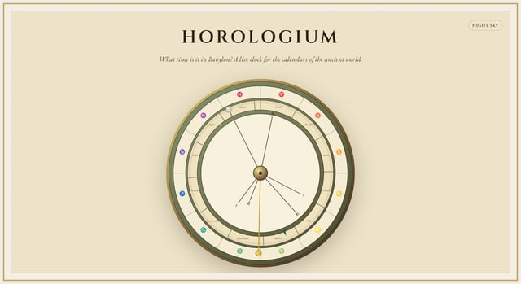</a>
 <strong><a href="https://github.com/antonsoo/horologium">horologium</a></strong> 
What time is it in Babylon? Thirteen ancient calendars, live, on an Antikythera-style dial.
</td>
<td width="33%" valign="top">
<a href="https://antonsoo.github.io/splitscope/">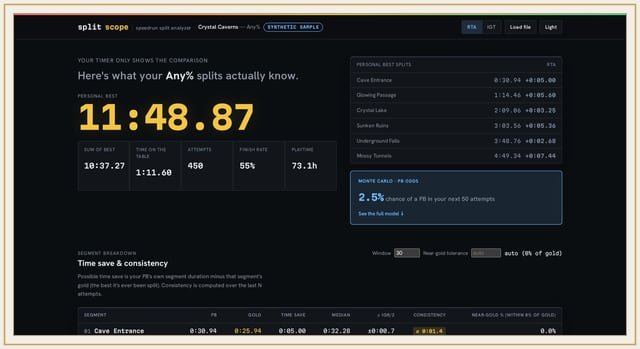</a>
 <strong><a href="https://github.com/antonsoo/splitscope">splitscope</a></strong> 
Reads a speedrunner's splits and prices the odds of the next personal best.
</td>
</tr>
</table>

The rest of the shelf:

| Repository | What it is |
| :-- | :-- |
| [contextscope](https://github.com/antonsoo/contextscope) | What fills an LLM context window, and why the prompt cache keeps missing. |
| [mcplint](https://github.com/antonsoo/mcplint) | Lints an MCP server's tools the way the model reads them. |
| [trainspotter](https://github.com/antonsoo/trainspotter) | Reads a training run's logs and names what went wrong. |
| [mergeglass](https://github.com/antonsoo/mergeglass) | Checks whether a LoRA update survived the merge, weight by weight, or quietly rounded away. |
| [flakemap](https://github.com/antonsoo/flakemap) | Finds the flaky tests in a CI history, with honest error bars. |
| [logdelta](https://github.com/antonsoo/logdelta) | Diffs logs by meaning, to show what the failing run did that the good one did not. |
| [ghostchars](https://github.com/antonsoo/ghostchars) | Finds the characters you cannot see: Trojan Source, invisible Unicode, smuggled prompts. |
| [stutterscope](https://github.com/antonsoo/stutterscope) | The stutter that an average frame rate hides. |
| [am-i-unlucky](https://github.com/antonsoo/am-i-unlucky) | Exact drop-rate and pity math: unlucky, or is it the system? |

**The ancient workshop.** Small laboratories for the sciences of the ancient world. Most let you work a procedure yourself, then read the source in its own language, beside the printed page.

| Repository | What it is |
| :-- | :-- |
| [stoicheia](https://github.com/antonsoo/stoicheia) | Euclid, Archimedes, and Pappus in Greek, Latin, and English, with working diagrams and the original printed pages. |
| [zygon](https://github.com/antonsoo/zygon) | Archimedes' balance and floating bodies: operate them first, then read the conditions in Greek. |
| [gonia](https://github.com/antonsoo/gonia) | Measured experiments in ancient architecture, from the Doric corner problem to Vitruvius' Ionic volute. |
| [syngraphe](https://github.com/antonsoo/syngraphe) | Turns a Greek building specification, the Piraeus naval storehouse, into a measured drawing. |
| [dioptra](https://github.com/antonsoo/dioptra) | Hero's tunnel survey and distance counter, and Frontinus' Latin water pipes, tested by trial. |
| [pnigeus](https://github.com/antonsoo/pnigeus) | The air regulator inside an ancient water organ, as Hero and Vitruvius describe it. |
| [pyknon](https://github.com/antonsoo/pyknon) | The ancient Greek interval that vanishes between modern piano keys, made audible. |
| [sammu](https://github.com/antonsoo/sammu) | An Old Babylonian procedure for retuning nine strings, one at a time, from manuscripts found at Ur. |
| [seked](https://github.com/antonsoo/seked) | Pyramid slopes from the Rhind papyrus in exact fractions, with the scribe's discrepancies left in. |
| [rajju](https://github.com/antonsoo/rajju) | Cord geometry from the Sanskrit Śulbasūtras: a circle rule that runs large, and a ground staked out with a marked cord. |
| [grama](https://github.com/antonsoo/grama) | The two grāmas of early Indian music: lower one string by a śruti, then read the Sanskrit. |
| [haidao](https://github.com/antonsoo/haidao) | Liu Hui's sea-island survey in Classical Chinese, and a divisor that passes one sighting and fails the next. |
| [shiguzhai](https://github.com/antonsoo/shiguzhai) | Ten ancient Chinese bronze bells: hear every reported pitch, and question the modern labels. |
| [planisphere](https://github.com/antonsoo/planisphere) | A printable star wheel for any latitude and any century, the sky over Babylon included. |
| [gnomon](https://github.com/antonsoo/gnomon) | Designs a working sundial for any place on Earth, ready to print or laser-cut. |
| [tonemirror](https://github.com/antonsoo/tonemirror) | Draws your pitch contour over a reference voice, for tones and pitch accent, Ancient Greek among them. |

Editors print Tacitus' shorter works together as his <em>opera minora</em>: the Agricola, the Germania, the Dialogus. These are mine, and a good deal cheerier.

**Earlier machine-learning work.** A few public pieces from before the shelf:

| Repository | What it is |
| :-- | :-- |
| [pneumonia-detection-xray-resnet](https://github.com/antonsoo/pneumonia-detection-xray-resnet) | A ResNet that reads chest X-rays for signs of pneumonia. |
| [DiplomAI](https://github.com/antonsoo/DiplomAI) | An LLM and speech-recognition assistant that defuses an argument in real time. |
| [LLM-Powered-Text-Enhancement-Suite](https://github.com/antonsoo/LLM-Powered-Text-Enhancement-Suite) | An LLM toolchain for rewriting, correcting, and sharpening prose. |
| [customer-churn-prediction-streamlit](https://github.com/antonsoo/customer-churn-prediction-streamlit) | Predicting who is about to leave, while there is still time to ask them to stay. |
| [codegen-llm](https://github.com/antonsoo/codegen-llm) | Experiments in teaching models to write code worth keeping. |

## Upstream fixes &nbsp;·&nbsp; Symbolae

In Terence, a young man at a dinner among friends *symbolam dedit, cenavit*: "paid his share, and dined" (Andria 88-89). A *symbola* was your share of the common table. These are mine, paid into other people's open-source projects and merged by their maintainers. A few favorites:

- **libtcod** ([#204](https://github.com/libtcod/libtcod/pull/204)): symmetric shadowcasting rounded negative half-ties the wrong way, so a roguelike hero could see floor tiles behind a wall. Now it sees what the walls allow.
- **python-sounddevice** ([#645](https://github.com/spatialaudio/python-sounddevice/pull/645)): in unsigned 8-bit audio, silence is 128, not 0. Channels meant to be silent had been carrying a DC signal.
- **Pipecat** ([#5989](https://github.com/pipecat-ai/pipecat/pull/5989)): Deepgram's HTTP voice could end a chunk halfway through a 16-bit sample, and a voice agent could go mute for the rest of the call.
- **ESPnet** ([#6865](https://github.com/espnet/espnet/pull/6865)): a training run that had stopped early trained one more epoch every time it was resumed. Stopped now means stopped.
- **raylib** ([#6198](https://github.com/raysan5/raylib/pull/6198), [#6199](https://github.com/raysan5/raylib/pull/6199)): BDF fonts load without crashing, and a malformed OBJ model no longer sends the loader reading past its own vertices.

| Field | Merged fixes of mine, by project |
| :-- | :-- |
| Speech and audio | [ESPnet](https://github.com/espnet/espnet/pulls?q=is%3Apr+author%3Aantonsoo+is%3Amerged) · [Lhotse](https://github.com/lhotse-speech/lhotse/pulls?q=is%3Apr+author%3Aantonsoo+is%3Amerged) · [sherpa-onnx](https://github.com/k2-fsa/sherpa-onnx/pulls?q=is%3Apr+author%3Aantonsoo+is%3Amerged) · [Pipecat](https://github.com/pipecat-ai/pipecat/pulls?q=is%3Apr+author%3Aantonsoo+is%3Amerged) · [python-soundfile](https://github.com/bastibe/python-soundfile/pulls?q=is%3Apr+author%3Aantonsoo+is%3Amerged) · [python-sounddevice](https://github.com/spatialaudio/python-sounddevice/pulls?q=is%3Apr+author%3Aantonsoo+is%3Amerged) · [pyfar](https://github.com/pyfar/pyfar/pulls?q=is%3Apr+author%3Aantonsoo+is%3Amerged) · [MeetEval](https://github.com/fgnt/meeteval/pulls?q=is%3Apr+author%3Aantonsoo+is%3Amerged) |
| Language and linguistics | [LingPy](https://github.com/lingpy/lingpy/pulls?q=is%3Apr+author%3Aantonsoo+is%3Amerged) · [pycldf](https://github.com/cldf/pycldf/pulls?q=is%3Apr+author%3Aantonsoo+is%3Amerged) · [csvw](https://github.com/cldf/csvw/pulls?q=is%3Apr+author%3Aantonsoo+is%3Amerged) · [clldutils](https://github.com/clld/clldutils/pulls?q=is%3Apr+author%3Aantonsoo+is%3Amerged) · [symspellpy](https://github.com/mammothb/symspellpy/pulls?q=is%3Apr+author%3Aantonsoo+is%3Amerged) |
| Machine learning | [Kornia](https://github.com/kornia/kornia/pulls?q=is%3Apr+author%3Aantonsoo+is%3Amerged) · [braindecode](https://github.com/braindecode/braindecode/pulls?q=is%3Apr+author%3Aantonsoo+is%3Amerged) · [TensorLy](https://github.com/tensorly/tensorly/pulls?q=is%3Apr+author%3Aantonsoo+is%3Amerged) · [NumPyro](https://github.com/pyro-ppl/numpyro/pulls?q=is%3Apr+author%3Aantonsoo+is%3Amerged) · [pycma](https://github.com/CMA-ES/pycma/pulls?q=is%3Apr+author%3Aantonsoo+is%3Amerged) · [PyPose](https://github.com/pypose/pypose/pulls?q=is%3Apr+author%3Aantonsoo+is%3Amerged) · [PyNNDescent](https://github.com/lmcinnes/pynndescent/pulls?q=is%3Apr+author%3Aantonsoo+is%3Amerged) · [StatsForecast](https://github.com/Nixtla/statsforecast/pulls?q=is%3Apr+author%3Aantonsoo+is%3Amerged) · [NeuralForecast](https://github.com/Nixtla/neuralforecast/pulls?q=is%3Apr+author%3Aantonsoo+is%3Amerged) · [pyts](https://github.com/johannfaouzi/pyts/pulls?q=is%3Apr+author%3Aantonsoo+is%3Amerged) · [Prince](https://github.com/MaxHalford/prince/pulls?q=is%3Apr+author%3Aantonsoo+is%3Amerged) · [scikit-network](https://github.com/sknetwork-team/scikit-network/pulls?q=is%3Apr+author%3Aantonsoo+is%3Amerged) · [NetworKit](https://github.com/networkit/networkit/pulls?q=is%3Apr+author%3Aantonsoo+is%3Amerged) |
| Reinforcement learning, games, and graphics | [Gymnasium](https://github.com/Farama-Foundation/Gymnasium/pulls?q=is%3Apr+author%3Aantonsoo+is%3Amerged) · [PettingZoo](https://github.com/Farama-Foundation/PettingZoo/pulls?q=is%3Apr+author%3Aantonsoo+is%3Amerged) · [MO-Gymnasium](https://github.com/Farama-Foundation/MO-Gymnasium/pulls?q=is%3Apr+author%3Aantonsoo+is%3Amerged) · [MushroomRL](https://github.com/MushroomRL/mushroom-rl/pulls?q=is%3Apr+author%3Aantonsoo+is%3Amerged) · [skrl](https://github.com/Toni-SM/skrl/pulls?q=is%3Apr+author%3Aantonsoo+is%3Amerged) · [raylib](https://github.com/raysan5/raylib/pulls?q=is%3Apr+author%3Aantonsoo+is%3Amerged) · [libtcod](https://github.com/libtcod/libtcod/pulls?q=is%3Apr+author%3Aantonsoo+is%3Amerged) · [python-tcod](https://github.com/libtcod/python-tcod/pulls?q=is%3Apr+author%3Aantonsoo+is%3Amerged) · [tcod-ecs](https://github.com/HexDecimal/python-tcod-ecs/pulls?q=is%3Apr+author%3Aantonsoo+is%3Amerged) · [Pymunk](https://github.com/viblo/pymunk/pulls?q=is%3Apr+author%3Aantonsoo+is%3Amerged) · [ModernGL](https://github.com/moderngl/moderngl/pulls?q=is%3Apr+author%3Aantonsoo+is%3Amerged) · [Ursina](https://github.com/pokepetter/ursina/pulls?q=is%3Apr+author%3Aantonsoo+is%3Amerged) · [vedo](https://github.com/marcomusy/vedo/pulls?q=is%3Apr+author%3Aantonsoo+is%3Amerged) · [FURY](https://github.com/fury-gl/fury/pulls?q=is%3Apr+author%3Aantonsoo+is%3Amerged) |
| Imaging, science, and statistics | [Pillow](https://github.com/python-pillow/Pillow/pulls?q=is%3Apr+author%3Aantonsoo+is%3Amerged) · [py-pde](https://github.com/zwicker-group/py-pde/pulls?q=is%3Apr+author%3Aantonsoo+is%3Amerged) · [scikit-fem](https://github.com/kinnala/scikit-fem/pulls?q=is%3Apr+author%3Aantonsoo+is%3Amerged) · [scikit-posthocs](https://github.com/maximtrp/scikit-posthocs/pulls?q=is%3Apr+author%3Aantonsoo+is%3Amerged) · [numpy-groupies](https://github.com/ml31415/numpy-groupies/pulls?q=is%3Apr+author%3Aantonsoo+is%3Amerged) · [Pingouin](https://github.com/raphaelvallat/pingouin/pulls?q=is%3Apr+author%3Aantonsoo+is%3Amerged) · [arch](https://github.com/bashtage/arch/pulls?q=is%3Apr+author%3Aantonsoo+is%3Amerged) · [LMFIT](https://github.com/lmfit/lmfit-py/pulls?q=is%3Apr+author%3Aantonsoo+is%3Amerged) · [qpsolvers](https://github.com/qpsolvers/qpsolvers/pulls?q=is%3Apr+author%3Aantonsoo+is%3Amerged) · [PyLops](https://github.com/PyLops/pylops/pulls?q=is%3Apr+author%3Aantonsoo+is%3Amerged) · [dill](https://github.com/uqfoundation/dill/pulls?q=is%3Apr+author%3Aantonsoo+is%3Amerged) · [Pint](https://github.com/hgrecco/pint/pulls?q=is%3Apr+author%3Aantonsoo+is%3Amerged) |
| Astronomy, earth, and life sciences | [galpy](https://github.com/jobovy/galpy/pulls?q=is%3Apr+author%3Aantonsoo+is%3Amerged) · [SpiceyPy](https://github.com/AndrewAnnex/SpiceyPy/pulls?q=is%3Apr+author%3Aantonsoo+is%3Amerged) · [SHTOOLS](https://github.com/SHTOOLS/SHTOOLS/pulls?q=is%3Apr+author%3Aantonsoo+is%3Amerged) · [PyAstronomy](https://github.com/sczesla/PyAstronomy/pulls?q=is%3Apr+author%3Aantonsoo+is%3Amerged) · [spectral-cube](https://github.com/radio-astro-tools/spectral-cube/pulls?q=is%3Apr+author%3Aantonsoo+is%3Amerged) · [RadVel](https://github.com/California-Planet-Search/radvel/pulls?q=is%3Apr+author%3Aantonsoo+is%3Amerged) · [cftime](https://github.com/Unidata/cftime/pulls?q=is%3Apr+author%3Aantonsoo+is%3Amerged) · [h5netcdf](https://github.com/h5netcdf/h5netcdf/pulls?q=is%3Apr+author%3Aantonsoo+is%3Amerged) · [Brian2](https://github.com/brian-team/brian2/pulls?q=is%3Apr+author%3Aantonsoo+is%3Amerged) · [DendroPy](https://github.com/jeetsukumaran/DendroPy/pulls?q=is%3Apr+author%3Aantonsoo+is%3Amerged) · [pyfaidx](https://github.com/mdshw5/pyfaidx/pulls?q=is%3Apr+author%3Aantonsoo+is%3Amerged) · [Pyteomics](https://github.com/levitsky/pyteomics/pulls?q=is%3Apr+author%3Aantonsoo+is%3Amerged) |

Every merged pull request, live: <a href="https://github.com/search?q=author%3Aantonsoo+type%3Apr+is%3Amerged+-user%3Aantonsoo&amp;type=pullrequests">the full list</a>, or <a href="https://github.com/search?q=author%3Aantonsoo+type%3Apr+-user%3Aantonsoo&amp;type=pullrequests">all of them</a>, open and closed. In the play, the young man's father was glad to hear it (<em>gaudebam</em>): paying your share was the respectable part of the evening.


Every script baked to vector paths: the Arabic joins, the Sanskrit ligates, the Hebrew runs right to left. Egyptian hieroglyphs live in the app.

  


The first row's adjective is Pliny's, who credits Archimedes with <em>machinalis scientia</em> (Natural History 7.125). The second row calls language models oracles; ask Croesus how far a fluent answer goes unchecked (Herodotus 1.53).

  


A new line each morning, set by a script in this repo, from people considerably wiser than me. The small word in the lower margin is the catchword: tomorrow's first word, the way scribes kept their quires in order.

  


GitHub sees only my open half; the busiest repositories are private. Roman numerals make any figure look deliberate.

  

<picture>
  <source media="(prefers-color-scheme: dark)" srcset="https://raw.githubusercontent.com/antonsoo/antonsoo/output/snake-dark.svg" />
  
</picture>

A serpent once grazed the offerings at Anchises' tomb, and Aeneas wondered if it was the spirit of the place (Aeneid 5.84-96). This one grazes on commits.

## Seeds &nbsp;·&nbsp; Sēmina

Two ideas sit in the drawer and receive the occasional weekend visit: a proper **game for learning ancient languages**, with a world in it rather than flashcards with confetti, and an app that finally teaches **music theory** the way theory deserves. Neither has moved to the bench; PRAVIEL holds the floor. Good seeds keep.

## Links &nbsp;·&nbsp; Vincula

<strong>ANTHONY</strong>

 

<strong>PRAVIEL</strong>

 

The banner, the cards, and the ledger were drawn by code in <a href="https://github.com/antonsoo/antonsoo/tree/main/scripts">/scripts</a>. Yes, even the Greek, the Hebrew, and the Gothic. <strong>Antōnius Mercātor, manū propriā.</strong>

